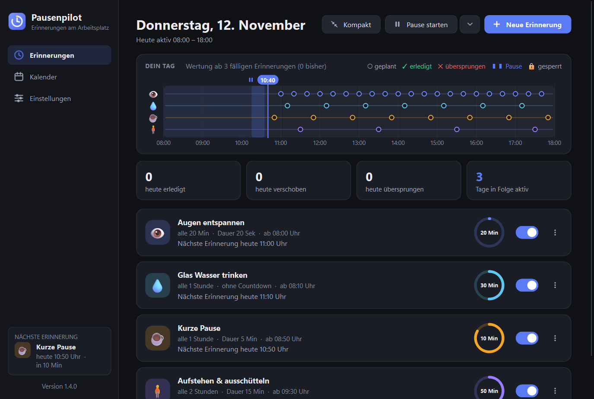
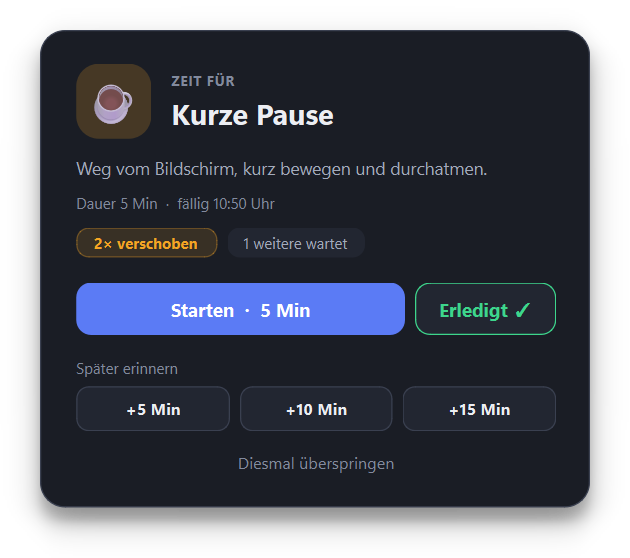
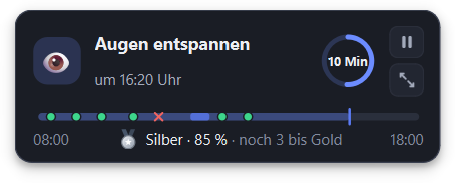
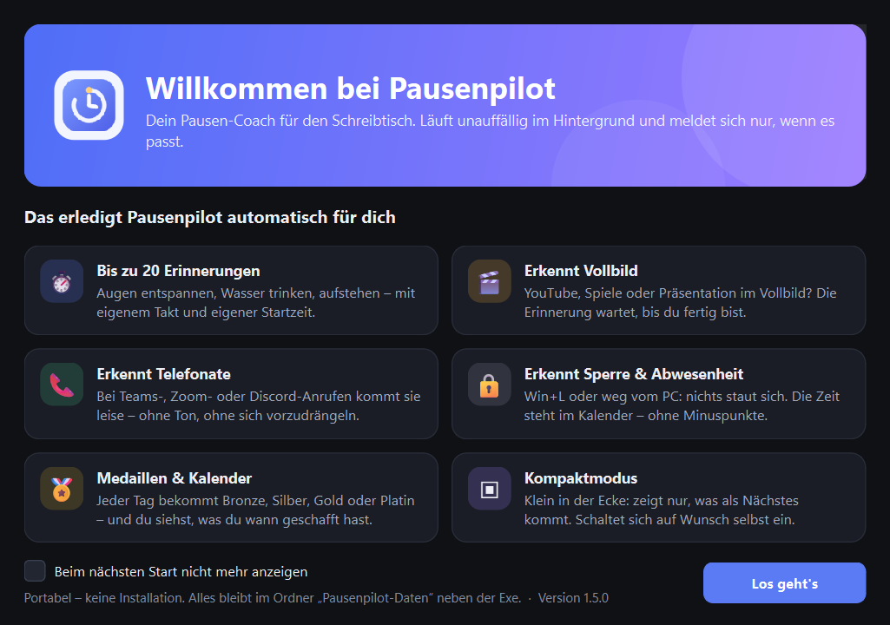

<div align="center">

# ⏱ Pausenpilot

**Dein Pausen-Coach für den Schreibtisch.**
Erinnert dich an Augen-Pausen, Wasser und Bewegung – und meldet sich nur, wenn es gerade passt.

[**⬇ Pausenpilot.exe herunterladen**](https://github.com/Kyou-Jin/Pausenpilot/releases/latest/download/Pausenpilot.exe)

Windows 10/11 · eine Datei · keine Installation



</div>

## So geht's

1. **Herunterladen**: `Pausenpilot.exe` in einen beliebigen Ordner legen.
2. **Starten**: Doppelklick. Drei Erinnerungen sind schon eingerichtet.
3. **Anpassen**: Takt, Dauer und Startzeit ändern – oder neue Erinnerungen anlegen. Fertig.

Pausenpilot läuft dann im Infobereich (unten rechts neben der Uhr) weiter.

> Windows zeigt beim ersten Start vielleicht „Der Computer wurde durch Windows geschützt“.
> Dann auf **Weitere Informationen → Trotzdem ausführen** klicken. Die Exe ist nicht signiert.

## Was Pausenpilot kann

| | |
|---|---|
| ⏱ **Bis zu 20 Erinnerungen** | Augen entspannen, Wasser trinken, aufstehen … jede mit eigenem Takt, eigener Dauer und Startzeit |
| 🎬 **Erkennt Vollbild** | YouTube, Spiele, Präsentationen – die Erinnerung wartet, bis du fertig bist |
| 📞 **Erkennt Telefonate** | Teams, Zoom, Webex, Skype, Discord, Slack: Erinnerung kommt leise, ohne Ton und ohne sich vor die Bildschirmfreigabe zu schieben |
| 🔒 **Erkennt Sperre & Abwesenheit** | Bei Win+L, Standby oder wenn du weg bist, staut sich nichts. Die Zeit steht im Kalender, ohne Minuspunkte |
| ✅ **Ehrlich zählen** | Eine Erinnerung gilt erst als erledigt, wenn du es bestätigst. Verschieben (+5/+10/+15 Min) wird gezählt |
| 📊 **Zeitstrahl „Dein Tag“** | Alles auf einen Blick: geplant, erledigt, übersprungen, Pausen |
| ⚠ **Überschneidungen erkennen** | Zeigt, wo sich Erinnerungen in die Quere kommen – mit Vorschlag zum Verschieben per Klick |
| 🔄 **Zeitplan aktualisieren** | Geänderte Startzeiten gelten auf Knopfdruck schon für heute |
| 🏅 **Medaillen** | Bronze, Silber, Gold oder Platin für jeden Tag – und einen Daumen nach unten, wenn's mal nichts war |
| 📅 **Kalender** | Was du wann gemacht hast, mit Pausen. Export als CSV |
| ▣ **Kompaktmodus** | Kleines Fenster in der Ecke, schaltet sich auf Wunsch von selbst ein |
| ⏸ **Pause** | Ein Klick – Erinnerungen ruhen, bis du die Pause beendest |
| 🌓 **Hell & dunkel** | Passt sich Windows an |

<p align="center">
  
  
</p>

<p align="center">
  
</p>

## Gut zu wissen

- **Deine Daten bleiben bei dir.** Alles liegt im Ordner `Pausenpilot-Daten` neben der Exe. Nichts geht ins Internet.
- **Mitnehmen:** Exe und Ordner zusammen kopieren – fertig. Für einen Neuanfang einfach den Ordner löschen.
- **Mit Windows starten:** in den Einstellungen einschalten.
- **Beenden:** Rechtsklick auf das Symbol im Infobereich → Beenden.

<details>
<summary><b>Für Entwickler</b></summary>

Python 3.11+ mit PySide6.

```
python -m pip install PySide6 pyinstaller
python run.py                          # starten
python tests/test_schedule.py          # Tests
powershell -File build.ps1             # dist/Pausenpilot.exe bauen
python tools/screenshots.py shots dark # Screenshots aller Ansichten
```

Ohne Installation testen, mit eigenem Datenordner: Umgebungsvariable `PAUSENPILOT_DATA` setzen.

</details>

## Lizenz

[MIT](LICENSE) – frei nutzbar, veränderbar und weitergebbar, solange der Lizenzhinweis erhalten bleibt.
